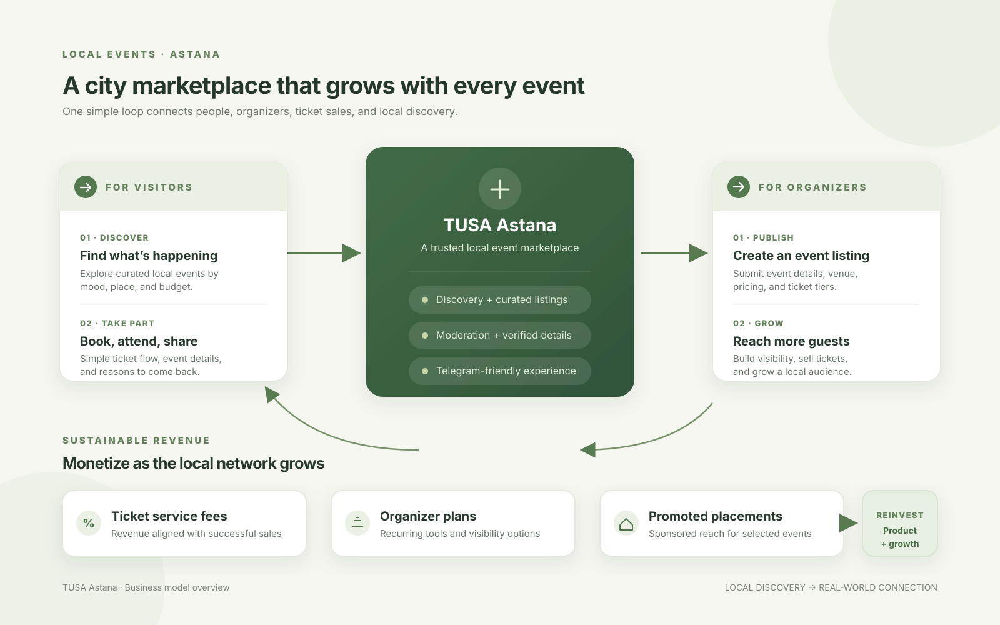
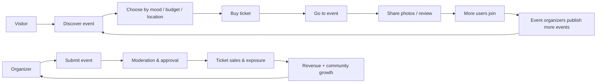
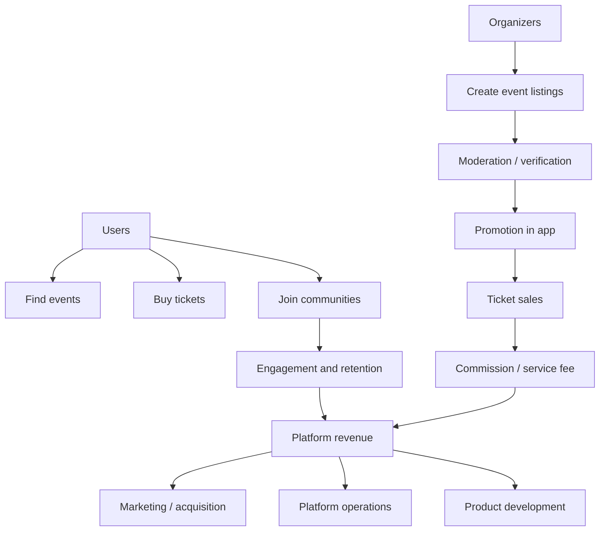
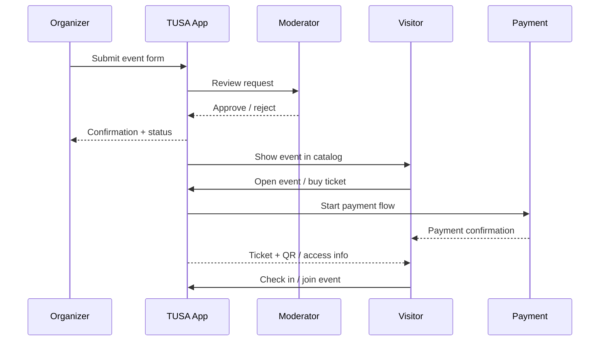
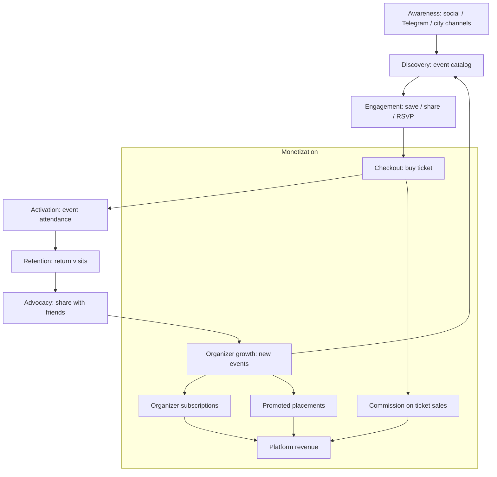
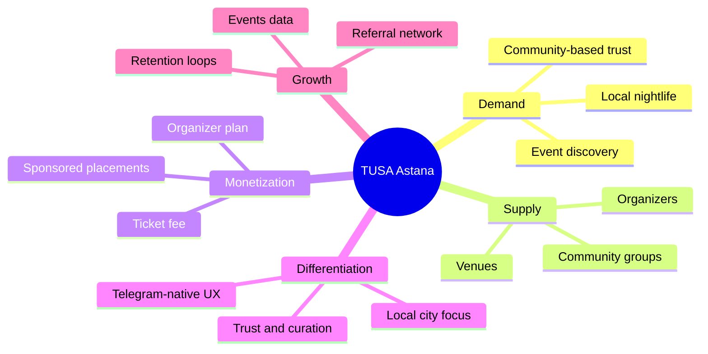

# TUSA Astana — Business Diagrams

## Business plans

- [Бизнес-план на русском языке](TUSA_BUSINESS_PLAN_RU.md)
- [Қазақ тіліндегі бизнес-жоспар](TUSA_BUSINESS_PLAN_KZ.md)

## Diagrams by language

- English: [business model image](../presentation-screenshots/tusa-business-model.svg)
- Русский: [схема бизнес-модели](../presentation-screenshots/tusa-business-model-ru.svg)
- Қазақша: [бизнес-модель сызбасы](../presentation-screenshots/tusa-business-model-kz.svg)

## Image version

Use the SVG directly in presentation software or export it to PNG at the required slide size.

## 1) Platform value loop

## 2) Core business model

## 3) Event lifecycle

## 4) Growth and retention funnel

## 5) Business opportunity summary

## Presentation narrative

- TUSA solves a local discovery problem: people do not know what is happening in Astana this evening.
- It creates a strong organizer funnel: submit event -> moderate -> publish -> sell tickets -> collect revenue.
- Each sold ticket improves engagement, creates social proof, and brings more organizers and visitors into the ecosystem.
- The most scalable revenue model is a combination of ticket commissions, organizer subscriptions, and sponsored placements.
- The product is especially attractive because it is integrated into Telegram and built around local events, which lowers the friction of both discovery and payment.
