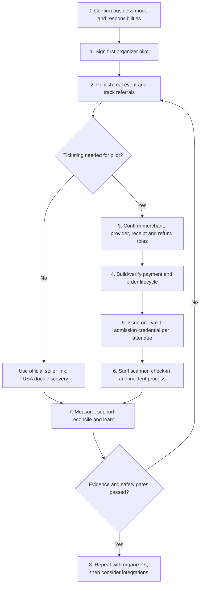
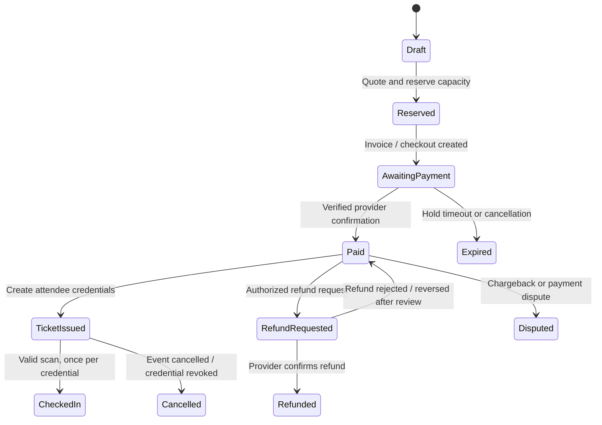

# TUSA Astana — Delivery Roadmap: Modules, Challenges & Launch Gates

**Purpose:** Turn the business idea into an ordered delivery plan covering sales, product, payment, QR admission, operations, and launch.  
**Status:** Working roadmap, not a claim that planned features or sales are already live.  
**Market:** Astana, Kazakhstan.  
**Rule:** Do not open real ticket sales until the applicable merchant, payment, receipt, refund, support, and check-in responsibilities are confirmed and tested.

## How to use this document

- **Implemented / partial** means there is code or a prototype, not necessarily production-ready operations.
- **Decision needed** means the founder must confirm the business/legal/provider choice before implementation can be finalized.
- **Done when** is evidence that closes a module; use it as a release gate.
- Deliver the smallest safe pilot first. A major concert with multiple ticket sellers is a later integration problem, not the first ticketing pilot.

## Delivery flow

## Current-state snapshot

| Module | Current evidence in the repository | Gap / caution |
|---|---|---|
| Event discovery and organizer submission | Angular event catalog, calendar, event detail, submission form; .NET API, moderation routes and SQLite/PostgreSQL support | A real organizer, permission to publish, stable production hosting, and maintained event inventory are still needed. |
| Payments | Backend Telegram invoice flow has payment states, capacity reservation/expiry, and provider charge references. Planning notes say live sales remain disabled until merchant approval and end-to-end testing. | Provider/merchant eligibility for KZT and the final production configuration must be confirmed. Keep sales disabled until a successful test and refund process are demonstrated. |
| QR display | A paid ticket can receive a QR payload; frontend renders it as an image. Event-page QR currently shares/opens the event page and is **not** an admission credential. | Current QR token is a short code; it should be upgraded before public use. A ticket row may represent quantity greater than one, while check-in marks the whole row used. |
| Check-in | Protected `POST /api/check-in/scan` verifies paid/not-refunded/not-used and records a check-in; admin/checker role is required. | A complete staff-facing scanner, event-scoped permissions, concurrency-safe scan handling, per-attendee tickets, offline/fallback operations, and venue rehearsal are not established by that endpoint alone. |
| External ticket platforms | No verified seller API integration is identified. | Start with a clearly labeled outbound official ticket link. Only promise unified inventory or TUSA validation after a written partner agreement and tested API. |
| Receipts and refunds | Backend stores payment/provider references and exposes support/refund-related states; some provider refunds require manual work. | A Telegram payment confirmation is not automatically the same as a Kazakhstan fiscal receipt. Confirm legal issuer, fiscalization method, delivery channel, cancellation, and refund workflow with the merchant/provider and qualified local accountant/legal adviser. |
| Business validation | Existing sales docs propose initial organizer outreach and pilot targets. | Treat prices, conversion rates, and growth targets as hypotheses until measured. No success claim without actual sales and reconciliation evidence. |

## Module roadmap and challenge cards

### M0 — Product boundary, roles and event model

**Challenge:** TUSA can be a discovery/referral product, a ticket seller, a ticketing technology provider, or a mix. Each role changes who takes payment, issues receipts, owns refunds, controls inventory, handles entry disputes, and stores customer data.

**Decision needed before pilot:** For each event, record whether TUSA is (A) discovery/referral only, (B) organizer-authorized ticket agent, or (C) seller/merchant of record. Do not imply that TUSA sells or validates tickets when it only links to another platform.

**Tasks:**
- Define organizer, venue, promoter, seller/merchant, TUSA operator, attendee, and door-staff responsibilities.
- Decide event types for the first pilot; avoid major multi-seller events as the first end-to-end test.
- Define source of truth for event details, ticket inventory, price, attendee identity, cancellations, and entry status.
- Establish data minimization and consent: only collect information needed to list, sell, deliver, support, and check in.

**Done when:** A one-page pilot sheet names the responsible party for ticket sale, payment, fiscal receipt, refund, customer support, personal data, entry decision, and event cancellation.

### M1 — First organizer, pilot contract and real supply

**Challenge:** A listing is not a commercial relationship. The organizer must authorize the event content, price, quantity, sales route, use of the organizer’s name/marks, data sharing, promotion, and operational responsibilities.

**Tasks:**
- Find 10 relevant prospects; qualify the next event, expected attendance, ticketing method, audience channel, decision-maker, and deadline.
- Close one small pilot with one organizer and one event. Prefer recurring/small capacity where staff can be present and the entry process can be rehearsed.
- Use a written pilot agreement or documented acceptance approved by local counsel. Include: parties, event and inventory, TUSA role, fees/commission, settlement timing, cancellation/refund policy, receipt issuer, data/controller roles, marketing permission, support contacts, and incident escalation.
- Get permission for event photos, logo, description, and promotion. Verify event date/venue and organizer contact.
- Agree a shared event runbook and a post-event review.

**Done when:** Signed/accepted pilot terms; verified event data; one named organizer operator and one named door lead; written ticket and cancellation policy; real event published with permission.

### M2 — Discovery, outbound ticket links and attribution

**Challenge:** Visitors need a dependable route to a ticket. An external seller’s QR is not automatically readable or valid in TUSA; an outbound link does not give TUSA the seller’s sales status unless the seller reports it.

**MVP approach:** For an event sold on an established platform, TUSA lists it as discovery/referral and links directly to the organizer’s official checkout. Label the seller clearly; do not display TUSA-generated admission QR for that purchase.

**Tasks:**
- Store official seller name, canonical checkout URL, seller terms/support destination, and last verification date.
- Add referral parameters/campaign ID only where permitted; disclose tracking as required.
- Monitor link clicks, but distinguish click attribution from confirmed ticket sales.
- Provide a broken-link/report route and a process for event-date or price corrections.
- Require organizer proof/authorization before publishing a seller link.

**Done when:** Visitor reaches the official checkout; the screen makes clear who sells the ticket; TUSA’s analytics do not mislabel outbound clicks as orders; organizer can correct or withdraw the link.

### M3 — Payment provider, merchant eligibility and commercial decision

**Challenge:** “Supports KZT” alone is insufficient. The merchant must be eligible, events must fit the provider’s terms, and payment notifications/refunds/settlement must reconcile to orders. A provider token in configuration does not prove production readiness.

**Decision matrix (get written answers):**
- Can this specific Kazakhstan merchant accept event-ticket payments in KZT through this flow?
- Is the provider available as a Telegram Bot Payments provider for this merchant, or is a separate hosted checkout/API required?
- Who is merchant of record and whose legal name appears to the customer?
- What are transaction fees, settlement currency/timing, reserves, chargebacks, dispute process, and refund costs?
- Does the provider supply idempotent webhooks, payment status lookup, refunds, and a stable transaction reference?
- How are the Kazakhstan fiscal receipt / online cash-register requirements satisfied, who issues the receipt, and how is it sent to the buyer?
- What are the required privacy/security, KYC, event-category, and support obligations?

**Provider selection:** Use one approved provider for the first TUSA-operated paid pilot. Compare (1) an eligible Telegram Bot Payments provider accepting KZT, if available for the merchant and event type, and (2) an approved Kazakhstan acquiring/PSP hosted checkout integrated by the backend. Do not assume Kaspi, Telegram, Robokassa, or any named service is approved/available until confirmed by the merchant and provider in writing. Avoid building multiple gateways before one path has passed a real test cycle.

**Done when:** Merchant/provider approvals are documented; production and test credentials are safely stored; payment, webhook, status lookup, settlement report, refunds, and receipt responsibilities are mapped; provider sandbox and live low-value tests pass.

### M4 — Order, inventory, payment and receipt lifecycle

**Challenge:** Payment can be duplicated, delayed, cancelled, timed out, refunded, or confirmed after an inventory hold expires. The system must never issue two admissions for one paid entitlement or silently lose money/stock.

**Target lifecycle:**

**Tasks:**
- Create an immutable order/payment reference and bind it to event, ticket type, quantity, price/currency, buyer, terms version, and hold expiry.
- Validate provider callbacks server-side, verify amount/currency/reference, and handle duplicate callbacks idempotently.
- Define atomic inventory reservation/release; test simultaneous last-seat purchases and late payment after expiry.
- Issue ticket credentials only after verified payment, or a documented free-registration entitlement.
- Keep an auditable status history: created, reserved, pending, paid, issued, expired, cancelled, refund requested, refunded, disputed.
- Reconcile orders against provider settlement, refunds, fees, and any cash/fiscal receipt records daily during pilot.
- Define receipt sequence: payment accepted -> fiscalization (if applicable) -> receipt delivery -> failed-receipt retry/support. Store receipt reference/status, not unnecessary payment-card data.

**Done when:** Test cases pass for success, user cancellation, timeout, duplicate callback, amount/currency mismatch, late success, refund, webhook outage/retry, and settlement reconciliation. Receipt/fiscalization responsibility and evidence are confirmed by qualified local advice/provider.

### M5 — QR credentials and admission model

**Challenge explained:** A QR code is only a machine-readable carrier. It does not itself prove a ticket is real. The scanner must resolve its opaque credential against TUSA’s authoritative ticket record and check event, status, refund/cancellation, validity window, and prior use. A screenshot can be copied; the first successful online redemption wins unless additional anti-fraud controls exist.

**Recommended model:**
- Do not put a person’s name, phone, payment data, or predictable ticket ID in the QR.
- Generate a cryptographically random, high-entropy, opaque credential per **attendee/admission**, not just one short code per order. Store a hash where practical; support revoke/regenerate.
- Keep an order separate from its admission tickets: an order for quantity 4 should normally create four individually scannable credentials and four named/unnamed attendee records, depending on the organizer’s policy.
- For one-person access, successful check-in atomically marks only that credential used. If the business intentionally sells a group pass, make its “one scan admits N people” rule explicit and record the count/door operator.
- Scan result should show event, ticket class, valid/invalid reason, remaining group admissions if relevant, and a clear duplicate warning—without exposing more attendee data than staff need.
- A public/event-page QR is for event discovery/share only; visually label it “Event info”, not “Ticket”.

**Current gap:** Existing paid tickets get a short `TUSA-...` code; the current model stores quantity on a ticket record; scan marks the record checked in. This is not sufficient for multiple independent admissions in a multi-ticket order without a deliberate grouped-pass rule and quantity-safe check-in.

**Done when:** Security review approves token entropy/storage; tests show each attendee entitlement is redeemable at most once; refunds/cancellations revoke admission; wrong-event, fake, expired, duplicated, and already-used codes return understandable results.

### M6 — Scanner app, staff roles and venue operations

**Challenge:** An API endpoint is not an entry operation. Door staff need fast feedback, correct event permissions, device/network readiness, privacy limits, escalation, and a process when scanning fails or two gates scan simultaneously.

**Tasks:**
- Build a staff-facing scan screen using device camera with manual-code fallback; request camera permission only when scanning starts.
- Assign a checker role scoped to an event and shift; support revoke, audit log, least privilege, and safe staff onboarding. Current broad admin/checker check should be reviewed for event scope.
- Prevent double admission under concurrency (database uniqueness/transaction/atomic conditional update); return first scan time/operator for duplicate resolution.
- Decide connectivity mode. Recommended first pilot: online-only with tested venue Wi‑Fi/mobile coverage plus paper/exported guest-list fallback controlled by lead staff. Offline scanning requires preloaded signed/limited credential data and later conflict reconciliation; do not improvise it on event day.
- Define gate setup, device charging, staff training, queue routing, ticket-search fallback, escalation contact, and final attendee count.
- Rehearse with demo tickets and a simulated network outage before doors open.

**Done when:** A load/field test matches expected throughput for the venue and device; multiple gates reject simultaneous duplicate scans; authorized staff see only their event; fallback and incident runbook have named owners.

### M7 — External ticket-platform integration

**Challenge:** Multiple sellers may have separate inventories, QR formats, privacy terms, APIs, and scanner systems. TUSA cannot validate or cancel another platform’s credential by decoding its QR. Two independent systems can also oversell shared seats.

**Stages:**
1. **Referral only (MVP):** verified official checkout link, seller label, referral tracking where allowed. Seller remains responsible for ticket and entry.
2. **Sales reporting:** organizer provides an authorized CSV/report or the seller supplies a documented webhook/API; reconcile sold/cancelled/refunded totals, with consent and minimal personal data.
3. **Credential validation:** only by written agreement and official API/SDK or approved scanner workflow. Define who owns inventory, customer support, refunds, data processing, uptime, and event-day responsibility.
4. **Unified inventory:** only if the seller/organizer API supports atomic holds/confirmations or a single inventory authority. Otherwise keep stock separate by channel and clearly disclose allocations.

**Done when:** Written partner approval, sandbox credentials, API/contract tests, privacy/data agreement, failure behavior, support contacts, settlement reconciliation, and a venue rehearsal are complete. Never market stage 1 as stage 3.

### M8 — Organizer contract, policy and customer support

**Tasks:**
- Produce a pilot agreement/order form and event content authorization.
- Define cancellation/postponement, partial/full refund, event change, no-show, duplicate/invalid ticket, entry refusal, payment dispute, and force-majeure handling.
- Identify seller/merchant of record, receipt issuer, refund decision-maker, and support SLA; confirm locally before launch.
- Publish customer terms, privacy notice, refund/cancellation policy, ticket delivery details, and support contact in the relevant languages.
- Establish an incident register and escalation path: organizer -> TUSA support -> payment provider/venue as applicable.
- Do not promise a refund, admission, receipt type, or partner capability before the responsible party confirms it.

**Done when:** Organizer and internal operator can answer “who handles this?” for every common complaint; one tabletop exercise covers cancellation and suspected duplicate/refunded ticket.

### M9 — Hosting, security, data and reliability

**Tasks:**
- Replace developer-machine/temporary-tunnel production dependencies with stable HTTPS hosting; configure backups, monitoring, logs, alerting, DNS, certificates, and restore test.
- Restrict CORS to known origins; protect secrets in a secret store; rotate leaked/obsolete credentials; configure trusted proxy/IP behavior safely.
- Verify Telegram `initData` on the backend for private and staff actions; never trust client-provided role, ticket status, or price.
- Rate-limit public event submissions and add anti-spam controls before public scale.
- Define retention, access, deletion, export, incident response, and processor agreements for attendee data.
- Test database backup restore and provider webhook retry/idempotency in staging.

**Done when:** Restore drill, security checklist, production secrets review, access-control tests, alert path, and stable HTTPS endpoints pass before live sales.

### M10 — Analytics, reconciliation and decision cadence

**Metrics:** organizer leads contacted/qualified/closed; authorized real events published; calendar/detail-to-outbound click; checkout start; verified paid order; ticket issued; scan success/duplicate/failed; refund/dispute; net revenue after provider fees/refunds; support response; repeat organizer; visitor repeat rate.

**Rules:**
- Separate mocks/demo traffic from real events and real payments.
- Do not count a seller-link click as a ticket sale without seller confirmation.
- Do not report gross ticket value as TUSA revenue; show commission/fees and refunds separately.
- Review pilot funnel and incidents at least weekly; make one explicit continue/change/stop decision.

**Done when:** A weekly report ties event IDs to analytics, order ledger, provider settlement, ticket issuance, check-ins, and refunds, with discrepancies assigned for resolution.

## Payment and receipt decision worksheet

| Question | Owner | Evidence required before go-live |
|---|---|---|
| Who is legally selling this event ticket? | Founder + organizer + local adviser | Signed agreement and customer-facing seller identity |
| Which provider can this merchant use for this ticket/event type in KZT? | Merchant + provider | Written eligibility, approved account, test and live low-value results |
| Who fiscalizes and issues the legally required receipt, if applicable? | Merchant + provider + local accountant/adviser | Written flow, sample receipt, delivery channel, correction/refund handling |
| Who handles cancellation/refund and how fast? | Organizer + merchant/provider | Published policy, tested refund and reconciliation evidence |
| Is Telegram Bot Payments the final checkout or is hosted checkout required? | Merchant + provider + product | Confirmed provider configuration and end-to-end test |
| What happens if payment succeeds after the inventory hold expires? | Product + finance/support | Automated stop/alert and documented refund/manual review path |

**Important:** Payment confirmation, provider invoice, bank statement, and fiscal receipt are distinct artifacts. Do not label one as another without confirmation of Kazakhstan requirements for the chosen merchant setup.

## Suggested delivery gates (not calendar promises)

1. **Gate A — Supply proof:** one organizer pilot accepted; one real event authorized and published; official seller link works if external ticketing is used.
2. **Gate B — Responsibility proof:** seller/merchant, receipt, cancellation, refund, data, and support owners documented.
3. **Gate C — Money proof:** eligible provider selected; verified test purchase/refund and settlement reconciliation pass; live sales remain off until then.
4. **Gate D — Admission proof:** valid ticket token per admission, scanner roles, duplicate protection, venue rehearsal, and fallback pass.
5. **Gate E — Repeatability:** at least one completed pilot review; real conversion and net economics measured; organizer agrees to repeat or pay.
6. **Gate F — Scale/integrate:** only after partner API/contract and operating support are proven; increase event capacity incrementally.

## Immediate next working session

1. Choose pilot model: discovery/referral-only or TUSA-managed ticketing. For a major concert using existing platforms, choose referral-only first.
2. Select one small/medium organizer event for an operational pilot and secure written authorization.
3. Fill the payment/receipt decision worksheet with organizer and eligible provider; ask a Kazakhstan accountant/legal adviser about fiscal receipt obligations for the exact merchant arrangement.
4. Decide if each admission is one attendee credential or a documented group pass; record current quantity/check-in gap as a blocker.
5. Assign one owner and proof artifact to each Gate A–E; keep live ticket sales disabled until the relevant gates pass.
