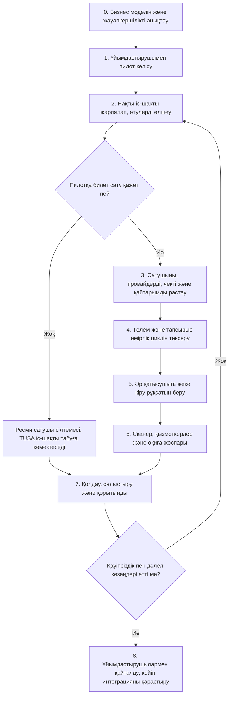
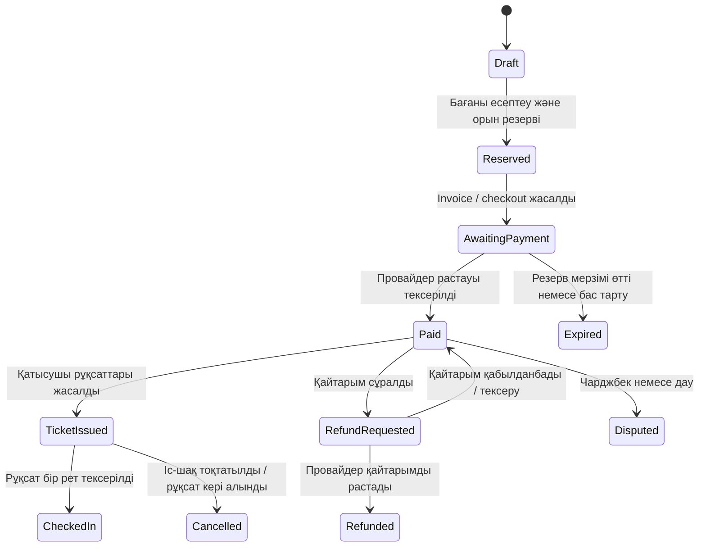

# TUSA Astana — Roadmap: модульдер, қиындықтар және іске қосу кезеңдері

**Мақсаты:** бизнес идеясын сату, өнім, төлем, QR арқылы кіру, операция және іске қосу бойынша реттелген жұмыс жоспарына айналдыру.  
**Мәртебесі:** жұмыс жол картасы; жоспарланған мүмкіндіктер не сатылым іске қосылды дегенді білдірмейді.  
**Нарық:** Қазақстан, Астана.  
**Ереже:** сатушының, төлемнің, чектің, қайтарымның, қолдаудың және іс-шаққа кіргізудің міндеттері расталып, тексерілмейінше нақты билет сатылымын ашпау.

## Құжатты пайдалану

- **Іске асқан / ішінара** — код немесе прототип бар, бірақ операциялық дайындық расталмаған.
- **Шешім қажет** — енгізуді аяқтамай тұрып негізін қалаушы бекітетін бизнес, құқықтық немесе провайдер таңдауы.
- **Дайын болады, егер** — модульдің аяқталғанын дәлелдейтін тексеріс.
- Алдымен ең шағын қауіпсіз пилотты өткізу керек. Бірнеше билет платформасы бар ірі концерт — кейінгі интеграция мәселесі, алғашқы билет пилоты емес.

## Іске асыру ағымы

## Қазіргі жағдайдың қысқаша көрінісі

| Модуль | Репозиторийде бар дәлел | Олқылық / ескерту |
|---|---|---|
| Іс-шақ афишасы және ұйымдастырушы өтінімі | Angular каталогы, күнтізбе, іс-шақ беті және форма; .NET API, модерация, SQLite/PostgreSQL қолдауы | Нақты ұйымдастырушы, жариялауға рұқсат, тұрақты production хостингі және өзекті афиша қажет. |
| Төлем | Backend-та Telegram invoice ағымы, төлем мәртебелері, орын резерві/мерзімі және provider charge сілтемелері бар. Жоспарда merchant мақұлдауы мен толық тестке дейін сатылым жабық делінген. | Нақты merchant үшін KZT және билет түріне рұқсатты растау керек. Нақты сынақ төлемі мен қайтарымы өтпейінше сатылым ашылмайды. |
| QR көрсету | Төленген билетке QR дерегі беріліп, frontend оны сурет ретінде көрсетеді. Іс-шақ бетіндегі QR ақпарат/бөлісуге арналған, **кіру билеті емес**. | Қазіргі код қысқа; жария сатылымға дейін күшейту керек. Бір билет жазбасындағы `quantity` бірнеше болуы мүмкін, ал check-in бүкіл жазбаны пайдаланылған деп белгілейді. |
| Check-in | Қорғалған `POST /api/check-in/scan` төлемді, қайтарым/бас тартуды және бұрын сканерленуді тексереді; admin/checker рөлі керек. | Endpoint өздігінен кіреберіс жұмысын қамтамасыз етпейді: сканер интерфейсі, іс-шақ бойынша рұқсат, қатар сканерлеуден қорғау, әр қатысушыға бөлек рұқсат, байланыс және алаңдағы репетиция қажет. |
| Сыртқы билет платформалары | Расталған seller API интеграциясы табылған жоқ. | Алдымен ресми сыртқы сілтеме. Келісім мен тексерілген API болмайынша ортақ орын саны немесе TUSA арқылы QR тексеру деп уәде бермеу. |
| Чек пен қайтарым | Backend төлем сілтемелері мен қолдау/қайтарым мәртебелерін сақтайды; кейбір provider қайтарымдары қолмен орындалуы мүмкін. | Telegram төлем растауы Қазақстандағы фискалдық чекке автоматты түрде тең емес. Чекті кім беретіні мен фискализацияны merchant, provider және жергілікті бухгалтер/заңгер нақты схемамен растауы керек. |
| Бизнес тексеруі | Сату құжаттарында ұйымдастырушыларға алғашқы байланыс пен пилот мақсаттары бар. | Баға, конверсия және өсу мақсаттары — өлшенбейінше болжам. Мақсатты қол жеткізілген нәтиже ретінде көрсетпеу. |

## Модуль жол картасы және қиындықтар

### M0 — Өнім шекарасы, рөлдер және іс-шақ деректері

**Қиындық:** TUSA оқиға іздеу/сілтеме сервисі, билет агенті, билет сатушысы немесе бірнеше рөлді қатар атқара алады. Рөл төлемді кім қабылдайтынын, чекті кім беретінін, қайтарымды, орын қорын, кіруге қатысты дауды және деректерді кім басқаратынын өзгертеді.

**Пилотқа дейінгі шешім:** әр іс-шақта TUSA рөлін бекіту: (A) тек табу/сілтеме, (B) ұйымдастырушының билет сату агенті, не (C) сатушы/merchant of record. Сатып алу басқа платформада болса, TUSA билет сатады немесе тексереді деген әсер қалдырмау.

**Міндеттер:** ұйымдастырушы, алаң, промоутер, сатушы/merchant, TUSA, қатысушы және есік қызметкерінің жауапкершілігін анықтау; бірінші пилот санатын таңдау; іс-шақ, билет қоры, баға, бас тарту және кіру мәртебесі бойынша дереккөзді белгілеу; тек қызметке қажет жеке деректерді жинау.

**Дайын болады, егер:** сатушы, төлем, фискалдық чек, қайтарым, қолдау, деректер, кіруге рұқсат беру және іс-шақты тоқтату үшін жауапты тарап көрсетілген бір беттік пилот парағы бар.

### M1 — Алғашқы ұйымдастырушы, пилот келісімі және нақты іс-шақ

**Қиындық:** афишада жариялану коммерциялық келісім болып саналмайды. Ұйымдастырушы контентті, бағаны, билет санын, сатып алу жолын, бренді мен дерек бөлісуді пайдалануға рұқсат беруі тиіс.

**Міндеттер:** 10 үміткерге байланысып, жақын іс-шақты, келушілерді, қазіргі билет платформасын, аудитория арнасын, шешім қабылдаушыны және мерзімді анықтау. Бір ұйымдастырушымен бір шағын пилот өткізу; кіреберісті тексеруге болатын қайталанатын, орын саны шектеулі шараны таңдаған жөн, алғашқы end-to-end сынақ ретінде үлкен концертті алмау. Келісімде тараптар, іс-шақ және қор, TUSA рөлі, комиссия, есеп айырысу, бас тарту/қайтарым, чек, деректер, маркетинг рұқсаты, қолдау және эскалация көрсетілсін. Фото, логотип және сипаттамаға рұқсат алып, күн/мекенжай/байланысты тексеру.

**Дайын болады, егер:** пилот шарттары қабылданды; мәлімет расталды; ұйымдастырушы мен кіреберіс жетекшісі тағайындалды; билет және бас тарту ережесі жазылды; нақты іс-шақ рұқсатпен жарияланды.

### M2 — Афиша, сыртқы билет сілтемелері және атрибуция

**Қиындық:** сыртқы сатушының QR-коды автоматты түрде TUSA-да жарамды болмайды. Сыртқы сілтеме де сатылымды білдірмейді: сатушы есеп бермейінше TUSA нақты тапсырысты білмейді.

**MVP жолы:** танымал платформада сатылатын үлкен концертке TUSA афишасын жасап, ұйымдастырушының ресми checkout сілтемесін беру. Сатушыны анық көрсету; TUSA QR-ды кіріс билеті ретінде көрсетпеу.

**Міндеттер:** сатушы атауын, ресми checkout URL-ін, қолдау/шарттарын және соңғы тексерілген күнін сақтау; рұқсат болса ғана referral белгісін қосу; сілтеме басуын нақты сатылымнан бөлек өлшеу; бұзылған сілтеме/күн/баға өзгерісін хабарлау арнасын ашу; сатушы сілтемесін жариялауға ұйымдастырушы өкілетін растау.

**Дайын болады, егер:** қатысушы ресми сатып алуға өтеді, билет сатушысы анық жазылған, аналитика сыртқы өтуді сатылым деп көрсетпейді және ұйымдастырушы сілтемені өзгерте/алып тастай алады.

### M3 — Төлем провайдері, merchant жарамдылығы және коммерциялық шешім

**Қиындық:** KZT қолдауының өзі жеткіліксіз. Нақты merchant осы билет түрін сата алуы, ал төлем, хабарлама, қайтарым және түсім тапсырыспен салыстырылуы керек. Конфигурациядағы provider токені production дайын деген сөз емес.

**Жазбаша жауап алу керек:** осы Қазақстан merchant-і осы іс-шақ түріне KZT қабылдай ала ма; оған Telegram Bot Payments қолжетімді ме, әлде жеке hosted checkout/API қажет пе; сатушы кім және сатып алушыға қандай заңды тұлға көрінеді; комиссия, төлем аудару мерзімі, резерв, чарджбек және қайтарым құны қандай; idempotent webhook, мәртебе іздеу және тұрақты транзакция ID бар ма; Қазақстандағы фискалдық чек талабын кім және қалай орындайды; KYC, құпиялылық, қолдау мен іс-шақ санаты бойынша міндеттер қандай?

**Таңдау:** алғашқы ақылы пилотқа бір мақұлданған төлем жолын ғана пайдалану. (1) нақты merchant пен іс-шаққа жарамды Telegram Payments KZT провайдерін, егер қолжетімді болса, және (2) backend арқылы қосылған мақұлданған қазақстандық acquiring/PSP hosted checkout нұсқасын салыстыру. Merchant пен provider жазбаша растамайынша Kaspi, Telegram, Robokassa немесе басқа бренд қолжетімді деп есептемеу. Бір толық ағым өтпей тұрып бірнеше шлюз қоспау.

**Дайын болады, егер:** merchant/provider мақұлдауы құжатталған; production құпия деректері қауіпсіз сақталған; checkout, webhook, есеп, қайтарым және чек міндеттері картаға түсірілген; sandbox және төмен сомалы live тест өткен.

### M4 — Тапсырыс, билет қоры, төлем және чек өмірлік циклі

**Қиындық:** төлем қайталануы, кешігуі, тоқтатылуы, мерзімнен шығуы немесе орын резерві біткеннен кейін расталуы мүмкін. Бір төлемге екі кіру құқығын беруге немесе ақша/орын есебін жоғалтуға болмайды.

**Мақсатты ағым:**

**Міндеттер:** өзгермейтін order/payment ID-ін іс-шаққа, билет түріне, санына, сома/валютаға, сатып алушыға, шарт нұсқасына және резерв мерзіміне байлау; серверде callback, сома, валюта мен ID-ді тексеріп, қайталануды idempotent өңдеу; орындарды атомарлық резервтеу/босату; соңғы орынға қатар екі сатып алу мен резервтен кейінгі кеш төлемді сынау; билетті тек төлем расталғанда немесе тіркелген тегін қатысуда беру; мәртебе тарихын сақтау; пилот кезінде тапсырысты, төлем аударымын, комиссияны, қайтарымды және чекті күн сайын салыстыру; фискализация/чек жіберу сәтсіз болса, қайталау және қолдау процесін дайындау, карта дерегін артық сақтамау.

**Дайын болады, егер:** сәтті төлем, бас тарту, таймаут, қайталанған callback, қате сома/валюта, кеш растау, қайтарым, webhook істемеуі және есеп салыстыру сынақтары өтсе. Фискализация рөлі provider мен жергілікті маманмен расталса.

### M5 — QR рұқсаты және кіру моделі

**Қиындық түсіндірмесі:** QR — тек машина оқитын ақпарат тасушы. Ол өздігінен билеттің шынайылығын дәлелдемейді. Сканер құпия/opaque токенді TUSA дерекқорымен салыстырып, іс-шақты, төлемді, қайтарым/бас тартуды, жарамдылық мерзімін және бұрын қолданылуын тексеруі керек. Скриншот көшірілуі мүмкін; қосымша қорғау болмаса, онлайн режимде бірінші сканерлеген көшірме өтеді.

**Ұсынылатын үлгі:** QR ішіне адамның аты-жөнін, телефонды, төлем дерегін немесе болжанатын ID-ді жазбау. Қысқа тапсырыс кодының орнына әр **қатысушы/кіру рұқсатына** криптографиялық кездейсоқ, энтропиясы жоғары құпия токен жасау; мүмкін болса хэшін сақтау, кері қайтару/қайта беру мүмкіндігін қосу. 4 билетке арналған тапсырыс әдетте 4 бөлек рұқсат жасауы керек. Егер бұл топтық билет болса, «бір скан — N адам» ережесін анық жазып, адамдар санын және қызметкерді тіркеу. Сканер нәтижесінде іс-шақ, билет түрі, жарамсыздық себебі, қалған топтық кіру саны және қайталанған скан ескертуі көрсетілсін; қызметкерге артық жеке дерек көрсетілмесін. Іс-шақ бетінің QR-ына «Іс-шақ ақпараты» деп белгі қойып, «Билет» демеу.

**Қазіргі олқылық:** төлемнен кейін қысқа `TUSA-...` код беріледі; саны бір билет жазбасында сақталады; check-in бүкіл жазбаны пайдаланылған деп белгілейді. Топтық билет ережесі мен санын есептеу арнайы шешілмесе, бұл бір тапсырыстағы бірнеше тәуелсіз кіруді қолдамайды.

**Дайын болады, егер:** токен беріктігі қауіпсіздік тексеруінен өтсе; әр рұқсат тек бір рет қолданылса; қайтарым/бас тарту рұқсатты жойса; жалған, басқа іс-шаққа тиесілі, мерзімі өткен және қолданылған QR түсінікті нәтиже берсе.

### M6 — Сканер, қызметкер рөлдері және алаңдағы жұмыс

**Қиындық:** API endpoint кіреберіс процесі емес. Қызметкерге жылдам жауап, іс-шақ бойынша нақты рұқсат, дайын құрылғы/желі, эскалация және резервтік тәсіл қажет.

**Міндеттер:** камера және қолмен код енгізу мүмкіндігі бар қызметкер экраны; камераға тек скан басталғанда рұқсат сұрау; checker рөлін белгілі іс-шақ/ауысымға шектеу, рұқсатты қайтарып алу және аудит; бір билетті қатар екі қақпада өткізбейтін атомарлық қорғаныс; байланыс тәртібін таңдау. Алғашқы пилотқа — алдын ала тексерілген Wi‑Fi/ұялы желі бар онлайн режим және жетекшіде сақталған қағаз/экспортталған қонақтар тізімі ұсынылады. Офлайн сканерлеу алдын ала жүктелген қолтаңбалы/шектеулі дерек пен кейінгі конфликт салыстыруын қажет етеді; шара күні импровизация жасамау. Қақпа/кезек бағытын, құрылғы қуатын, үйретуді, билет іздеуді, эскалация байланысын және қонақ санын дайындау. Демонстрациялық билеттермен және желіні өшіру жаттығуымен репетиция өткізу.

**Дайын болады, егер:** алаң мен құрылғы жүктеме сынағынан өтсе; бірнеше қақпада қатар сканерлеу қайтарылса; қызметкер тек өз іс-шақтарын көрсе; резервтік процесс пен инцидент жоспарының жауаптылары тағайындалса.

### M7 — Сыртқы билет платформаларымен интеграция

**Қиындық:** әр сатушыда бөлек билет қоры, QR форматы, дерек саясаты, API және сканер бар. TUSA басқа платформаның QR кодын шешіп оқу арқылы оның билетін тексеріп немесе жоя алмайды. Екі жүйе бір орындарды бөлек сатып, артық сата алады.

**Кезеңдер:** 1) **Тек сілтеме (MVP):** ресми checkout, сатушының атауы, рұқсат етілсе атрибуция; билет пен кіруге сатушы жауап береді. 2) **Сату есебі:** ұйымдастырушы/сатушы берген рұқсат етілген CSV, webhook немесе API арқылы сатылған/бас тартылған/қайтарылған сандарын салыстыру; жеке деректі азайту. 3) **Рұқсатты тексеру:** тек жазбаша келісім және ресми API/SDK не бекітілген сканер ағымы арқылы; орын, қолдау, қайтарым, дерек және шара күні бойынша жауаптыны бекіту. 4) **Біріккен билет қоры:** тек seller API атомарлық резерв/растауды қолдаса немесе бір ғана жүйе қорды басқарса. Әйтпесе әр арнаға бөлек квота беріп, оны анық көрсету.

**Дайын болады, егер:** жазбаша серіктестік рұқсаты, sandbox деректері, API келісім сынақтары, дерек келісімі, ақау кезіндегі тәртіп, қолдау байланысы, төлем есебі және алаңдағы репетиция дайын. 1-кезеңді 3-кезең деп жарнамаламау.

### M8 — Ұйымдастырушы келісімі, саясат және қолдау

Пилот келісімі мен контент рұқсатын дайындау; тоқтату/ауыстыру, толық/ішінара қайтарым, кіргізбеу, қайталанған/жарамсыз билет, чарджбек және форс-мажорды белгілеу. Merchant/чек/қайтарым/қолдау уақыты/деректер рөлін жергілікті маманмен растау. Қажетті тілдерде шарт, құпиялылық саясаты, қайтарым тәртібі, билет жеткізу және қолдау байланысын жариялау. Эскалация: ұйымдастырушы -> TUSA қолдауы -> қажет болса провайдер/алаң. Жауапты тарап растамайынша қайтарым, кіру, чек түрі немесе серіктес мүмкіндігін уәде етпеу.

**Дайын болады, егер:** ұйымдастырушы мен оператор жиі болатын шағымға кім жауап беретінін білсе; іс-шақты тоқтату және билет көшірмесі/қайтарымы күдігіне үстелдік жаттығу өткізілсе.

### M9 — Хостинг, қауіпсіздік, деректер және сенімділік

Уақытша туннельді/әзірлеуші компьютерін тұрақты HTTPS хостингіне ауыстыру; backup, мониторинг, журнал, alert, DNS, сертификат және қалпына келтіру тестін қосу. CORS-ты шектеу; құпияларды secret store-де сақтау; сенімді proxy/IP-ды дұрыс баптау. Жеке және қызметкер әрекеттерінде Telegram `initData`-ны серверде тексеру; браузерден келген рөлге, бағаға және билет күйіне сенбеу. Ашық формаға rate limit пен спамға қарсы бақылау қосу. Қатысушы деректерін сақтау, қолжеткізу, жою және экспорт мерзімін анықтау. Staging-та дерекқорды қалпына келтіруді және webhook қайталауын тексеру.

**Дайын болады, егер:** live сатылымға дейін қалпына келтіру жаттығуы, қауіпсіздік чек-листі, production құпиялары мен рөлдер сынағы, alert жолы және тұрақты HTTPS endpoint өтсе.

### M10 — Аналитика, есеп салыстыру және басқару тәртібі

Өлшемдер: ұйымдастырушы лидтері (байланыс/сәйкестік/келісім), рұқсатпен жарияланған нақты іс-шақтар, сыртқы сілтеме басуы, checkout, расталған төлем, билет берілуі, сәтті/қайталанған/қате скан, қайтарым/дау, провайдер комиссиясынан кейінгі таза табыс, қолдау жауабы, қайталама ұйымдастырушы және келуші.

Демо мен нақты трафик/ақшаны бөлек ұстау; сыртқы сілтемеге өтуді сатушы растамайынша сатылым деп санамау; билет толық айналымын TUSA табысы деп көрсетпеу; апта сайын пилотты жалғастыру/өзгерту/тоқтату туралы шешім шығару.

**Дайын болады, егер:** апта есебі іс-шақ ID-лерін аналитикамен, тапсырыс журналымен, provider төлемімен, билеттермен, скан және қайтарыммен байланыстырып, айырмашылыққа жауапты тағайындаса.

## Төлем және чек шешім парағы

| Сұрақ | Жауапты | Іске қосуға дейінгі дәлел |
|---|---|---|
| Бұл билет сатылымын заңды түрде кім жүргізеді? | Негізін қалаушы + ұйымдастырушы + жергілікті кеңесші | Қабылданған келісім және сатып алушыға көрсетілетін сатушы атауы |
| Merchant үшін осы билет пен KZT-ге қай provider жарамды? | Merchant + provider | Жазбаша рұқсат, бекітілген есептік жазба, тесттер |
| Қажет болса фискализация мен чекті кім береді? | Merchant + provider + бухгалтер/кеңесші | Жазбаша ағым, чек үлгісі, жеткізу және қайтарым тәртібі |
| Қайтарымды кім мақұлдайды және мерзімі қандай? | Ұйымдастырушы + merchant/provider | Жария саясат және сыналған қайтарым |
| Төлем Telegram Payments арқылы ма, әлде hosted checkout па? | Merchant + provider + өнім тобы | Расталған конфигурация және толық тест |
| Резерв біткен соң төлем расталса не болады? | Өнім + қаржы/қолдау | Автоматты тоқтату/ескерту және қайтару/тексеру процесі |

**Маңызды:** төлем растауы, provider invoice, банк көшірмесі және фискалдық чек — әртүрлі құжаттар. Нақты merchant схемасына арналған Қазақстан талабын растаусыз бірін екіншісі деп атауға болмайды.

## Ұсынылатын іске қосу кезеңдері (күнтізбелік уәде емес)

1. **Gate A — ұсыныс:** бір ұйымдастырушымен пилот келісілді; нақты іс-шақ жариялауға рұқсат алды; сыртқы сатушы болса, ресми сілтеме жұмыс істейді.
2. **Gate B — жауапкершілік:** сатушы, чек, бас тарту, қайтарым, дерек және қолдау иелері жазбаша анықталды.
3. **Gate C — ақша:** жарамды provider таңдалды; тест сатып алу/қайтарым және түсімді салыстыру өтті; оған дейін нақты сатылым жабық.
4. **Gate D — кіргізу:** әр рұқсатқа жеке токен, сканер рөлі, қайталанудан қорғау, алаң репетициясы және резервтік процесс дайын.
5. **Gate E — қайталану:** пилот аяқталды, нақты конверсия мен экономика өлшенді, ұйымдастырушы қайталауға не төлеуге дайын.
6. **Gate F — масштаб/интеграция:** тек серіктес келісімі мен жұмыс қолдауы дәлелденгеннен кейін; көлемді біртіндеп арттыру.

## Келесі жұмыс кездесуі

1. Пилот моделін таңдаңыз: тек афиша/сілтеме немесе TUSA билеті. Бірнеше сыртқы платформамен сатылатын ірі концертке алдымен ресми сатушыға бағыттау моделін таңдаған дұрыс.
2. Шағын/орта іс-шақ ұйымдастырушысын тауып, жазбаша жариялау рұқсатын алыңыз.
3. Төлем/чек шешім парағын ұйымдастырушы және қолжетімді PSP-пен толтырыңыз; Қазақстандағы нақты merchant схемасына қатысты фискалдық чек міндетін бухгалтер/заңгерден тексеріңіз.
4. Бір қатысушыға бір QR ма, әлде ережесі жазылған топтық билет пе — шешіңіз; қазіргі `quantity` пен check-in айырмасын блокер ретінде тіркеңіз.
5. A–E кезеңдерінің әрқайсысына жауапты және дәлел файлын тағайындаңыз; қажет gate өтпейінше сатылым ашпаңыз.
