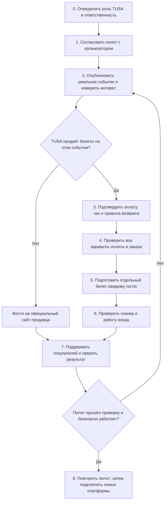
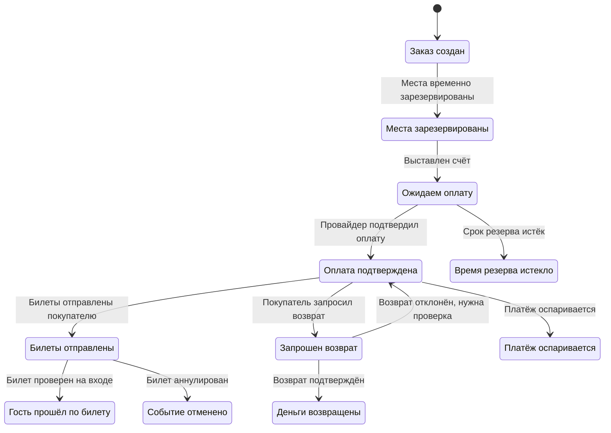

# TUSA Astana — Roadmap: план работ, открытые вопросы и запуск

**Цель:** собрать в одном месте всё, что нужно для запуска TUSA: от первого договора с организатором до продажи билета, прохода по QR-коду и поддержки гостей.  
**Статус:** рабочий план. Упоминание задачи здесь не означает, что она уже выполнена или запущена.  
**Рынок:** Астана, Казахстан.  
**Главное правило:** не начинать реальные продажи, пока не понятно, кто продаёт билет, принимает оплату, выдаёт чек, оформляет возврат и отвечает покупателю. Сам процесс прохода на мероприятие тоже нужно заранее проверить.

## Как пользоваться документом

- **Уже есть / сделано частично** — функция присутствует в коде или прототипе, но её ещё нужно проверить в реальной работе.
- **Нужно решить** — вопрос, на который владелец проекта должен ответить до разработки или запуска.
- **Можно считать готовым, когда** — конкретный результат можно показать и проверить.
- Начинайте с небольшого безопасного пилота. Концерт, билеты на который продают сразу несколько платформ, — не лучший первый тест: сначала нужно разобраться с интеграциями и общей билетной квотой.

## В каком порядке запускать проект

## Снимок текущего состояния

| Модуль | Что уже видно в репозитории | Пробел / предостережение |
|---|---|---|
| Афиша и заявки организаторов | В приложении уже есть календарь, каталог, страницы событий и форма подачи. В API предусмотрены модерация и работа с SQLite/PostgreSQL. | Нужны реальный организатор, разрешение на публикацию, стабильный сервер и актуальные события. |
| Оплата | В API есть заготовка оплаты через счёт Telegram, статусы заказа, резервирование мест и сроки ожидания. | Продажи должны оставаться выключенными, пока провайдер и схема работы не одобрены, а покупка и возврат не проверены от начала до конца. |
| Билетный QR-код | После подтверждения оплаты билет может получить QR-код, который приложение показывает покупателю. QR-код на странице события ведёт на страницу события и **не даёт права на вход**. | Сейчас один заказ может содержать несколько билетов, но отметка о проходе ставится на весь заказ. Нужно определить, как учитывать вход каждого гостя. |
| Проверка билета на входе | Защищённый метод `POST /api/check-in/scan` проверяет оплату, отмену/возврат и повторное сканирование. Доступна роль администратора или контролёра. | Одного API-метода недостаточно: нужны экран сканирования, права контролёра на конкретное событие, защита от одновременных сканов, план на случай проблем со связью и репетиция на площадке. |
| Другие билетные платформы | Подтверждённой интеграции с внешними продавцами в проекте пока нет. | На первом этапе размещать официальную ссылку продавца. Не обещать проверку чужого QR-кода или общий остаток билетов без договора и работающей интеграции. |
| Чеки и возвраты | API сохраняет данные платежей и статусы возврата; часть возвратов может требовать ручной обработки у провайдера. | Сообщение об оплате не обязательно является фискальным чеком. Кто обязан выдать чек и как его отправлять покупателю, нужно уточнить для выбранной схемы у продавца, провайдера и местного специалиста. |
| Проверка спроса | В документах описаны поиск первых организаторов и цели пилота. | Цены, конверсии и цели роста пока являются предположениями. Результатами их можно считать только после измерений. |

## Roadmap по этапам: что сделать и как проверить результат

### M0 — Границы продукта, роли и модель события

**Почему это важно:** TUSA может только показывать событие и вести на сайт продавца, помогать организатору продавать билеты или продавать их от своего имени. От этого зависит, кто принимает деньги, выдаёт чек, возвращает средства, управляет остатком билетов и отвечает за данные покупателя.

**Решение до пилота:** письменно зафиксировать роль TUSA для конкретного события: (A) афиша со ссылкой на продавца; (B) сервис, который продаёт билеты по поручению организатора; (C) продавец билетов от своего имени. Если покупка проходит на другой платформе, не создавать впечатление, что билет продаёт или проверяет TUSA.

**Что сделать:** распределить обязанности между организатором, площадкой, продавцом и TUSA; выбрать тип первого мероприятия; определить, где хранится актуальная информация о событии, цене и количестве билетов; собирать только те данные гостей, которые действительно нужны.

**Можно считать готовым, когда:** для пилотного события составлен краткий документ с ответами: кто продаёт билет, принимает оплату, выдаёт чек, оформляет возврат, отвечает покупателю, работает с данными и решает вопросы на входе или при отмене.

### M1 — Первый организатор, договор пилота и реальные события

**Почему это важно:** публикация события сама по себе не даёт права продавать билеты или использовать материалы организатора. Нужно заранее согласовать цену, количество билетов, способ покупки, логотипы, передачу данных и правила входа.

**Что сделать:** связаться с 10 подходящими организаторами и выяснить, какое событие у них ближайшее, сколько обычно приходит гостей, где сейчас продаются билеты и кто принимает решение. Договориться об одном небольшом пилоте. Для первого теста лучше выбрать регулярное событие с ограниченным числом мест, где можно заранее проверить вход, а не большой концерт. В договоре или письменном согласии указать стороны, событие и количество билетов, роль TUSA, комиссию и расчёты, правила отмены и возврата, порядок выдачи чека, работу с данными, разрешение на рекламу и контакты для поддержки. Отдельно получить разрешение на фото, логотип и описание; перепроверить дату, место и контакты.

**Можно считать готовым, когда:** условия пилота согласованы, событие и материалы проверены, назначены контакт со стороны организатора и ответственный за вход, правила билетов и отмены записаны, публикация одобрена.

### M2 — Афиша и ссылки на покупку билетов

**Почему это важно:** QR-код, выданный другой билетной платформой, не становится проверяемым кодом TUSA. И переход на внешний сайт ещё не означает, что билет купили: для подтверждения продажи нужен отчёт продавца.

**Первый вариант:** если билеты на большой концерт продаёт известная платформа, разместить событие в TUSA и дать ссылку на официальную страницу покупки. Рядом указать, кто именно продаёт билет. Не показывать QR TUSA как билет на вход.

**Что сделать:** записывать название продавца, официальную ссылку, контакты поддержки и дату проверки ссылки. Метки для учёта переходов добавлять только с разрешения. Считать переходы отдельно от подтверждённых покупок. Предусмотреть способ сообщить об изменении цены, даты или неработающей ссылке. Перед публикацией проверять, что организатор разрешил разместить ссылку.

**Можно считать готовым, когда:** ссылка ведёт на официальный сайт покупки, продавец указан, переход не записывается как продажа, а организатор может обновить или снять объявление.

### M3 — Выбор платёжного провайдера и схема приёма оплаты

**Почему это важно:** мало того, что провайдер принимает тенге. Он должен разрешать конкретному продавцу принимать оплату за билеты, а TUSA должна уметь связать каждый платёж с заказом и проверить возвраты и выплаты. Наличие токена в настройках ещё не означает, что система готова к реальным продажам.

**Что нужно выяснить у провайдера и продавца:** разрешено ли этому продавцу принимать оплату за такой тип билетов в тенге; можно ли использовать Telegram Payments или понадобится отдельная защищённая страница оплаты; кто будет указан продавцом для покупателя; каковы комиссии, сроки выплат, удержания, оспаривание платежа и стоимость возврата; можно ли надёжно проверить статус платежа и отличить повторное уведомление от новой оплаты; кто формирует фискальный чек и отправляет его покупателю; какие требования действуют к проверке продавца, данным покупателей и поддержке.

**Как выбирать:** для первого платного пилота подключить только один одобренный способ. Сравнить: (1) провайдера Telegram Payments, который действительно доступен продавцу для оплаты билетов в тенге; (2) одобренный в Казахстане банк или платёжный сервис с отдельной защищённой страницей оплаты. Не считать Kaspi, Telegram, Robokassa или другой сервис подходящим, пока продавец и провайдер письменно это не подтвердили. Не подключать несколько способов оплаты, пока один из них не прошёл полный цикл испытаний.

**Можно считать готовым, когда:** есть подтверждение провайдера и продавца; секретные ключи хранятся безопасно; описаны приём платежа, уведомления, сверка денег, возвраты и чеки; тестовые платежи и небольшой реальный платёж успешно прошли.

### M4 — Что происходит с заказом и оплатой на каждом этапе

**Почему это важно:** платёж может задержаться, прийти повторно, не пройти или подтвердиться уже после того, как резерв мест закончился. Система должна правильно обработать каждый сценарий, не выдать лишние билеты и не потерять деньги или места.

**Как должен проходить заказ:**

**Что сделать:** присваивать каждому заказу уникальный номер и сохранять его событие, тип и количество билетов, сумму и валюту, покупателя, срок резерва и принятую версию условий. Проверять серверные уведомления провайдера, сумму, валюту и номер заказа; повторное уведомление не должно создавать второй платёж или второй билет. Надёжно резервировать и освобождать места. Проверить одновременную покупку последнего места и запоздавшее подтверждение оплаты. Выдавать билет только после подтверждённой оплаты или регистрации бесплатного гостя. Вести историю изменений статуса. Во время пилота ежедневно сверять заказы с выплатами, комиссиями, возвратами и чеками. Предусмотреть повторную отправку чека и обращение в поддержку, не сохраняя лишние данные банковской карты.

**Можно считать готовым, когда:** проверены успешная оплата, отмена, истечение срока, повторное уведомление, неверная сумма или валюта, поздняя оплата, возврат и временная недоступность провайдера. Выплаты сверяются с заказами, а порядок выдачи чека подтверждён провайдером и местным специалистом.

### M5 — QR-допуски и модель входа

**Почему QR-кода недостаточно:** это просто изображение с кодом, который можно скопировать. При сканировании система должна обратиться к базе TUSA и проверить, что билет относится к этому событию, оплачен, не возвращён и ещё не использован. Если один и тот же QR показывают на двух телефонах, пройти должен только первый подтверждённый скан.

**Как лучше сделать:** не записывать в QR имя, телефон, платёжные данные или легко угадываемый номер. Создавать отдельный случайный код для каждого **билета на одного гостя**, а не один короткий код на весь заказ. Должна быть возможность аннулировать или перевыпустить код. Если покупатель берёт четыре билета, обычно нужно выдать четыре QR-кода. Для группового билета отдельно описать правило, например: «один QR пропускает до четырёх человек», а сотрудник фиксирует фактическое количество. После сканирования сотрудник видит название события, тип билета и понятный результат проверки; лишние данные гостя ему не нужны. QR для страницы события подписывать как «Подробнее о событии», а не «Билет».

**Что сейчас не сходится:** после оплаты создаётся короткий код `TUSA-...`. Количество билетов хранится в одной записи заказа, а проверка на входе помечает использованной всю запись сразу. Поэтому заказ на несколько билетов пока нельзя корректно использовать как несколько отдельных проходов.

**Можно считать готовым, когда:** код нельзя просто угадать, каждый билет проходит только один раз, возврат или отмена аннулирует право входа, а поддельный, чужой, просроченный или уже использованный код получает понятный отказ.

### M6 — Сканер и организация входа на мероприятие

**Почему одного серверного метода недостаточно:** на площадке сотруднику нужны простой экран, быстрый ответ «пропустить / не пропустить», доступ только к своему событию и понятный запасной план, если пропадёт интернет или сломается камера.

**Что подготовить:** экран сканирования камерой телефона и ручной поиск по коду; запрашивать доступ к камере только при запуске сканера. Выдавать контролёру доступ лишь к нужному событию и смене, вести журнал проверок и уметь быстро отозвать доступ. Защитить систему от ситуации, когда два турникета одновременно принимают один билет. Для первого пилота выбрать проверку через интернет и заранее испытать связь на площадке. У старшего смены иметь распечатанный или выгруженный список для поиска билетов при сбое. Полностью автономная проверка без интернета требует отдельной разработки и последующей сверки — её нельзя вводить накануне мероприятия. Подготовить зарядные устройства, обучение персонала, схему очереди, контакт ответственного и репетицию с демонстрационными билетами.

**Можно считать готовым, когда:** сканер выдерживает ожидаемый поток гостей, повторный билет не проходит на других воротах, контролёры видят только своё событие, а у персонала есть проверенный план на случай сбоя.

### M7 — Подключение других билетных платформ

**Почему это сложно:** у каждой платформы свои билеты, остатки мест, правила работы с данными и оборудование для входа. TUSA не сможет проверить или отменить чужой билет, просто считав его QR-код. Если две платформы продают одни и те же места независимо друг от друга, билеты могут быть проданы сверх вместимости.

**Как подключаться поэтапно:**

1. **На старте — ссылка на продавца.** Разместить официальную страницу покупки, указать продавца и вести посетителя туда. Продажей и входом занимается эта платформа.
2. **Затем — подтверждение продаж.** По согласованию получать отчёт или подключить API/серверные уведомления, чтобы сверять число проданных, отменённых и возвращённых билетов. Не передавать лишние данные покупателей.
3. **Проверка билета TUSA.** Возможна только с письменного разрешения платформы и через её официальный API или одобренный способ проверки. Заранее определить, кто отвечает за остатки, поддержку, возвраты и работу на входе.
4. **Общий остаток билетов.** Подключать только если платформы умеют надёжно резервировать и подтверждать одни и те же места или если остатком управляет одна система. В остальных случаях заранее разделить количество билетов между каналами.

**Можно считать готовым, когда:** получено письменное разрешение на интеграцию, пройдены тесты с платформой, согласованы правила обмена данными и действия при сбое, известны контакты поддержки, сверяются продажи и проведена репетиция на площадке. Не называть обычную ссылку интеграцией или проверкой билета.

### M8 — Договор организатора, правила и поддержка

Подготовить договор пилота и получить разрешение на публикацию материалов. Заранее описать, что происходит при отмене или переносе события, возврате всей суммы или её части, отказе во входе, чужом или повторно использованном билете, споре по платежу и форс-мажоре. Вместе с местным специалистом уточнить, кто указан продавцом, кто выдаёт чек, кто оформляет возврат и кто отвечает за данные покупателей. Опубликовать условия покупки, правила возврата и контакты поддержки на нужных языках. Установить порядок разбора проблем: организатор -> поддержка TUSA -> продавец или площадка. Не обещать покупателю то, за что отвечает другая сторона, пока она это не подтвердила.

**Можно считать готовым, когда:** организатор и команда TUSA знают, кто решает типовые проблемы покупателей, а отмена события и подозрение на поддельный или возвращённый билет разобраны заранее.

### M9 — Надёжная работа сайта и защита данных

Перенести API с временного туннеля и компьютера разработчика на постоянный HTTPS-хостинг. Настроить резервные копии, мониторинг, журналы ошибок, уведомления и проверку восстановления данных. Ограничить доступ к сайту и API, хранить секретные ключи в защищённом хранилище. Проверять Telegram `initData` на сервере и не доверять роли, цене или статусу билета, пришедшим из браузера. До открытия публичной формы добавить защиту от спама и ограничение частоты заявок. Определить, кто и как долго хранит данные гостей, кто имеет к ним доступ и как их удалить. В тестовой среде проверить восстановление базы и повторную доставку уведомлений об оплате.

**Можно считать готовым, когда:** проверены резервная копия и восстановление, доступы и секреты защищены, роли работают правильно, а уведомления об ошибках доходят до ответственного до открытия реальных продаж.

### M10 — Результаты пилота и план дальнейших действий

Измерять путь от первого разговора с организатором до повторного сотрудничества: сколько организаторов откликнулись, сколько событий опубликовано с разрешения, сколько посетителей открыли карточку и перешли к покупке, сколько оплат подтверждено, сколько билетов выдано и использовано. Отдельно учитывать неудачные и повторные сканы, возвраты, споры, расходы на комиссии, чистый доход и время ответа поддержки.

Отделять демонстрационные данные от реальных событий и платежей. Переход на сайт продавца не считать продажей, пока продавец её не подтвердил. Не путать общую сумму проданных билетов с выручкой TUSA. Раз в неделю решать, продолжать пилот, изменить его или остановить.

**Можно считать готовым, когда:** недельный отчёт показывает путь от просмотра события до оплаты и входа, а за расхождения между заказами, выплатами, возвратами и сканированиями назначен ответственный.

## Что нужно решить по оплате и чекам

| Вопрос | Кто уточняет | Что должно быть подтверждено до запуска |
|---|---|---|
| Кто выступает продавцом билета? | Основатель, организатор и местный консультант | Согласованные условия и понятное покупателю название продавца |
| Какой способ оплаты можно использовать для этих билетов в тенге? | Организатор-продавец и провайдер | Письменное подтверждение, одобренный аккаунт и успешный тест |
| Кто выдаёт фискальный чек, если он требуется? | Продавец, провайдер и бухгалтер/консультант | Понятный порядок, образец чека, способ доставки и исправления ошибок |
| Кто оформляет возврат и в какие сроки? | Организатор-продавец и провайдер | Опубликованные правила и проверенный возврат средств |
| Где покупатель оплачивает билет: в Telegram или на отдельной странице? | Продавец, провайдер и команда продукта | Подтверждённый способ оплаты и пройденная проверка от начала до конца |
| Что делать, если оплата пришла после окончания резерва места? | Команда продукта и поддержки | Понятное уведомление и порядок проверки или возврата денег |

**Важно:** уведомление об оплате, счёт провайдера, банковская выписка и фискальный чек — разные документы. Какой именно чек нужно выдавать покупателю, следует уточнить для выбранной схемы продажи у провайдера и местного специалиста.

## Условия, после которых можно переходить к следующему этапу

1. **Этап A — договорились с организатором:** событие настоящее, разрешение на публикацию получено, официальная ссылка на билеты работает.
2. **Этап B — распределили ответственность:** письменно указано, кто продаёт билеты, принимает оплату, выдаёт чек, оформляет возврат и отвечает покупателям.
3. **Этап C — проверили оплату:** провайдер одобрил продавца, тестовая покупка и возврат прошли, выплаты сверяются. До этого реальные продажи выключены.
4. **Этап D — проверили вход:** каждому гостю выдаётся правильный билет, повторный скан блокируется, персонал обучен, репетиция и запасной план готовы.
5. **Этап E — оценили пилот:** известны реальные продажи, расходы и проблемы; организатор готов провести следующий пилот или оплатить услугу.
6. **Этап F — готовимся к росту:** интеграции с другими платформами подключаются только по договору; количество событий и билетов увеличивается постепенно.

## С чего начать сейчас

1. Решить, будет TUSA только показывать афишу и вести на сайт продавца или продавать билеты самостоятельно. Для большого концерта пока использовать официальный сайт продавца.
2. Найти небольшое или среднее мероприятие и получить от организатора письменное разрешение.
3. Вместе с продавцом и провайдером заполнить таблицу по оплате и чекам; уточнить требования к фискальному чеку у специалиста в Казахстане.
4. Определить, получает ли каждый гость отдельный QR-код или организатор продаёт групповой билет. Исправление учёта нескольких билетов в одном заказе записать в ближайшие задачи.
5. Назначить ответственного за каждый этап запуска и заранее определить, чем будет подтверждено его выполнение. Реальные продажи не включать, пока необходимые проверки не пройдены.
